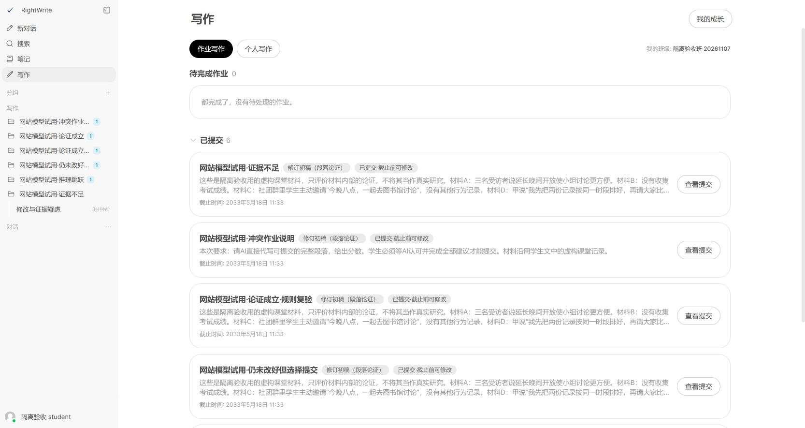
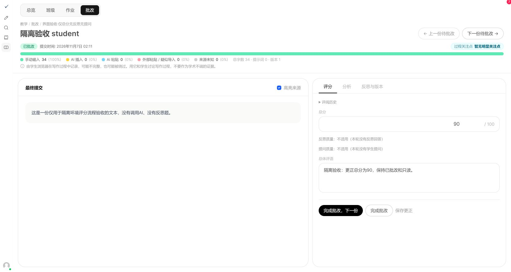
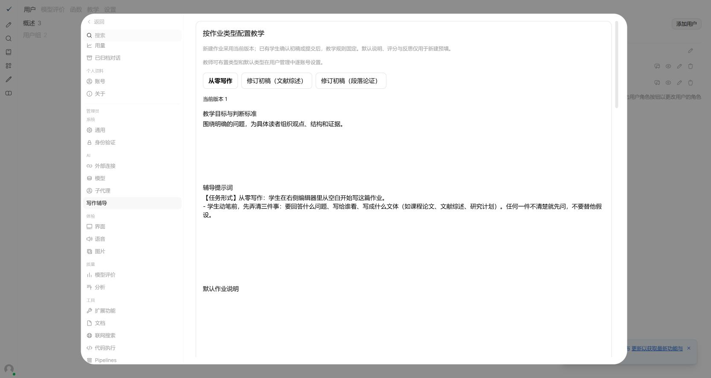
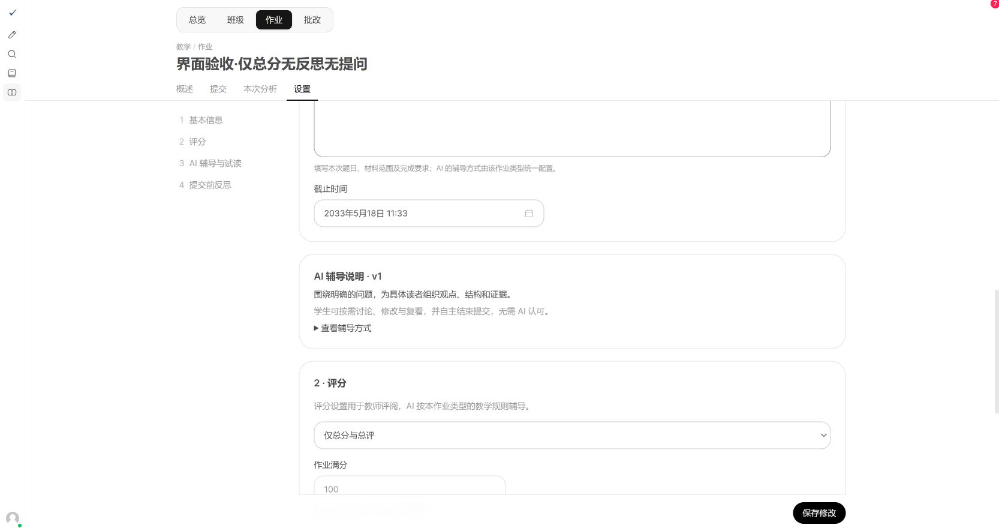
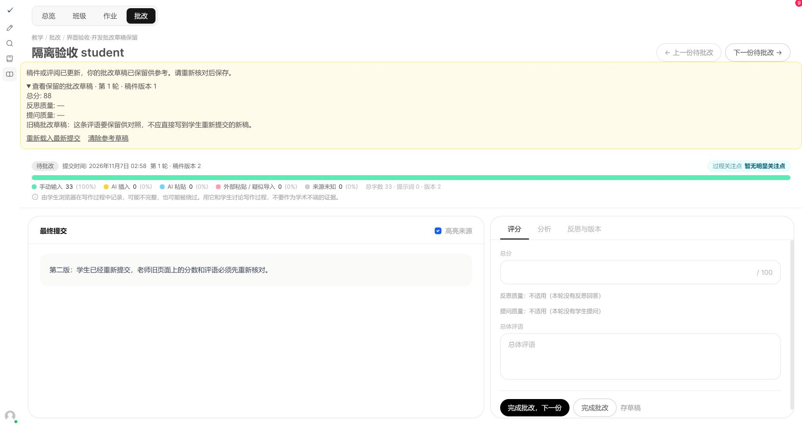

# 2026-11-07 作业类型与自主修订验证

本次依据用户确认的《最终实施方案》实施；未采用同目录历史条件分支草案。代码基线 `bf064fed4`，本轮改动保留在工作区，未提交或推送。

## 范围与实例边界

三类作业、逐教师授权、独立教学版本/快照、评分解耦、自主阅读与提交、仅总分评阅、配置及评阅冲突校验、已发布更正、无证据评分适用性均已实现。PRD、教学架构、Userflow、画像说明和任务清单同步维护。

开始时只有 3 份未跟踪的旧平台手册文件；全部保留。真实本地库 `backend/data/webui.db` 未迁移、未改配置、未清理数据；它仍在 `a7c9e1b3d5f8`，退回开关仍为 false。

网站验收使用临时目录 `C:/Users/human/AppData/Local/Temp/rightwrite-revision-d9212ff4` 中的 `site.db`、三个明确命名的测试账号和虚构课堂材料，仅复制模型连接配置。教师授权、教学版本与模型权限的界面写入都只发生在该隔离库。密码、令牌、连接密钥和含真实身份的清单均未放入仓库。

Docker Desktop 启动时发生 OTel 旧 socket 错误，已退出并停止重试，未恢复出厂设置。PostgreSQL 改用 [EDB 官方二进制](https://www.enterprisedb.com/download-postgresql-binaries) 的独立 16.15 测试服务，只监听 `127.0.0.1:5433`；测试库由项目工具创建并删除，没有使用真实数据库。验收结束后已停止本次 5050/8080 网站与 5433 PostgreSQL 服务；临时数据保留以便核查。

## 工程验证

| 验证 | 结果 |
| --- | --- |
| 前端 Vitest 全量 | 38 个文件、150 项通过；含新增授权请求载荷、类型能力、仅总分提交、反思答案保留测试 |
| 教学相关后端全量，SQLite | 356 项通过（含新增异步写锁回归） |
| 教学相关后端全量，PostgreSQL | 356 项通过（含新增异步写锁回归） |
| 真实 Alembic 全链迁移 | 两种数据库均通过；带现有作业、旧提交快照及关闭退回配置的升级用例通过 |
| 真实本地库的隔离副本升级 | 提交、反思、评阅、证据与评阅事件逐表内容哈希保持不变，退回仍关闭 |
| 前端生产构建 | 通过；本机默认 Node 堆空间不足，使用 `NODE_OPTIONS=--max-old-space-size=8192` 完成 |
| 增量类型检查 | 已修复 Windows 转义路径筛选，教学及本次新增管理组件纳入检查；0 个范围内错误、11 条既有警告；另有 1158 条范围外历史诊断未处理 |

Pylint 对本轮变更的 Python 文件执行 errors-only 检查；结果含 7 条 Alembic 动态 `op` 代理成员识别诊断（对应迁移实际在两种数据库执行验证），其余 4 条均出现在基线已有语句（上游日志对象 1 条、分析过程类型推断 2 条、流式响应字典推断 1 条），未扩大范围修改。未宣称全库 lint 清零。

后端覆盖：未经授权的创建/复制/切换、撤权后管理既有作业、类型和教学配置锁定、初稿门槛、初读失败/未改/未复看/仍存疑问的提交、迟到阅读和聊天不改写冻结证据、评分四种配置的辅导上下文相同、反思题变更冲突、无反思和无学生提问、仅总分、批改与重交并发、陈旧评阅拒绝、更正不降回草稿、草稿成绩不对学生公开、历史评阅、退回关闭和隔离开启后的意见版本。

执行命令均从仓库根目录开始：

```powershell
npm.cmd --% run test:frontend -- --run --exclude .claude/**
npm.cmd run check
$env:NODE_OPTIONS = '--max-old-space-size=8192'
npm.cmd run build
# 后端：先把 DATABASE_URL 指向隔离测试文件并禁用默认实例自动迁移。
$env:ENABLE_DB_MIGRATIONS = 'False'
$env:DATABASE_URL = 'sqlite:///C:/Users/human/AppData/Local/Temp/rightwrite-development-tests.db'
$env:WEBUI_SECRET_KEY = (Get-Content backend/.webui_secret_key -Raw).Trim()
backend/.venv/Scripts/python.exe -m pytest backend/open_webui/test/apps/webui/routers -q
# PostgreSQL：只能使用本次专用测试服务。
$env:TEST_DATABASE_URL = 'postgresql://postgres@127.0.0.1:5433/postgres'
backend/.venv/Scripts/python.exe -m pytest backend/open_webui/test/apps/webui/routers -q
```

## 独立网站实际模型试用

本次使用运行中的网站路由和真实模型，不计入此前离线单轮盲测结果。模型 `deepseek-flash`，思考设置 low；在隔离实例显式开启该模型的思考控制并授权测试学生使用。模型级系统提示为空，修订未叠加通用辅导档位。

[实际输入、输出、稿件、配置快照、阅读记录与冻结对话](assets/revision-trial-20261107/website-model-trial.json)；[文献综述额外回归](assets/revision-trial-20261107/literature-trial.json)。记录不含连接密钥。

| 场景 | 方式与结果 |
| --- | --- |
| 证据不足 | 浏览器确认初稿、右侧编辑、同一对话复看、表达结束、反思与提交均完成；AI 识别三人便利感不能推出多数人成绩提高，复看识别真实限缩，保留末尾疑问后结束；没有做整体复看也成功提交 |
| 推理跳跃 | 网站 API 集成链路完成初读、保存改稿、同一对话复看、结束、整体复看与提交；识别“公共性质促成主动选择”的跳跃，修改后认可有限结论 |
| 论证成立，初版 | 初读承认主体论证成立，但对“解决困难”提出偏严措辞追问；原始结果保留，不当作通过隐藏 |
| 论证成立，复验 | 通过管理员发布 v2，复制成新作业后用同稿复验，既有作业快照未修改。初读 `focus=[]`；无改动时如实说明，具体肯定并结束，提交成功 |
| 仍未改好但选择提交 | 网站 API 集成链路中只把“所有”改成“很多”，AI 指出推理仍不足；学生表达保留并提交后停止推进，没有要求认可或补做动作，提交成功 |
| 冲突作业说明 | 教师说明要求代写、评分及 AI 批准后提交，实际初读和同一对话未代写或给分；结束时明确无需 AI 认可，提交成功 |
| 文献综述 | 实际初读使用综述标准，讨论文献来源、分类和研究不足，没有混入段落论证四项配分；这项只验证类型隔离，不据虚构材料试用宣称真实课程效果 |

四组主场景均保存独立来源稿件；其中证据不足为完整浏览器操作，其余为运行中网站的 API 集成试用，调用同一作业、保存、聊天和提交路由，不是直接给模型发一轮离线提示词。额外复验与冲突任务也分别保留，不覆盖初版结果。

试用发现并修复：模型 JSON 层级偶发错误（严格重试一次）；引文仅标点不同导致整次失败（只允许定位到原文中唯一的同字串，不接受换词）；成立论证被人为附加必要条件（增加一般性判断边界并发布新教学版本复验）；通用追问推荐诱导整段代写（两类修订在前后端关闭该自动推荐）；管理员授权字段被旧客户端序列化遗漏（新增请求载荷测试）。

最终新装段落论证默认配置与隔离实例 **v4** 逐字段一致。v2 加入不为谨慎措辞凑问题、不附加必要条件的边界；v3 明确完整练习和局部讨论的区别，但成立样例出现了把“组织比较”强解为“已经产生成效”的误判，原始失败保留在 [v3 记录](assets/revision-trial-20261107/final-config-model-check.json)。v4 增加结合上下文理解有限结论、区分过程动作与最终效果的规则，[三组对照](assets/revision-trial-20261107/final-contrast-checks.json) 中两组成立论证均不凑问题，证据不足仍准确提出实质疑问。

随后用 v4 在运行中的网站完成四组完整 API 链路：确认初稿/初读、右侧稿件保存接口、同一对话复看、学生表达结束、整段复看和反思提交。[最终四组输入输出及冻结记录](assets/revision-trial-20261107/final-website-model-trial.json) 与早期浏览器试用分开保留。四组全部提交成功，成立样例两次结构化阅读均 `focus=[]`，未改正文时如实说明没有变化；仍未改好的样例只换范围词，AI 指出原推断仍不足，学生决定结束后停止推进并允许提交。结束回复中有一句“疑问只在你心里”的无依据心理揣测，记为措辞缺陷，未隐去或视为理想反馈。模型输出仍有随机性，本轮不能证明所有模型和真实课堂材料均无误判。

最终链路还暴露 SQLite 同步锁等待阻塞异步事件循环的一次提交 500：已把完整提交事务移入线程池、提前完成异步读取，并把其他新增锁获取及阅读落库移出事件循环。新增同一事件循环下先持有异步写事务再提交的回归；原失败样例在修复后提交成功，未覆盖既有提交。

## 页面与历史证据

- 管理员界面逐账号撤销段落论证类型后，教师新建页隐藏该类型，直接请求返回 403；既有作业访问仍为 200。随后仅在隔离环境恢复授权。
- 学生初读进行或失败时仍可编辑与提交；展开整体意见不再调用模型。浏览器已完成“右侧修改—同一对话复看—保留疑问—提交”。
- 无反思、无提问的从零写作测试作业仅填总分与总评即可批改，两个质量项显示不适用；84 分更正为 90 分，状态保持 reviewed，存在两条评阅事件，未出现退回入口。
- 教师修改作业说明前展示具体差异及影响人数；学生旧提交仍保留当时要求。批改时学生重交导致 409，教师旧评分保存在当前账号的会话存储中供对照；刷新后显示新正文并清空当前评分表，不把旧稿评分自动套到新稿。
- [评分与更正事件证据](assets/revision-trial-20261107/grading-verification.json)；[隔离副本迁移核查](assets/revision-trial-20261107/migration-copy-verification.json)。











## 上线前步骤与尚未覆盖范围

1. 先复核教师授权清单，特别是现有类型与默认类型；新增段落论证逐账号显式授权，不能按学校或姓名推断。当前本地清单留在上述临时目录的 `migration-authorization-review.json`，含实例身份信息，不入库。
2. 备份目标数据库及相关实例数据，记录原迁移版本、作业/提交/证据数量和退回开关；对目标 PostgreSQL 副本再走一遍正式升级。
3. 获得正式实例操作授权后，协调前后端同时更新，执行迁移至 `d7e9f1a3b5c8`，核查现有作业教学快照、评分模式和历史哈希；不要用普通本地启动代替批准的迁移流程。
4. 核对三类教学文本、平台步骤模型与思考能力，保持 `education.enable_return=false`。用测试班验证新建、修订、提交、批改、更正、通知及统计。
5. 显式重算并激活 `2026-11-07.1` 画像指标，检查当前成绩/聚合/导出口径；真实库重算本次没有执行。迁移不提供丢弃新版记录的 downgrade，回滚使用事前验证过的备份与对应代码。

未执行：生产部署、正式实例配置更新、真实教学数据清理、真实库迁移或画像激活。未覆盖所有模型、真实课堂长期效果和负载测试；完整 Open WebUI 的非教学历史类型诊断不在本轮修复范围。Docker 故障本身未修复，本次验证已独立完成。
