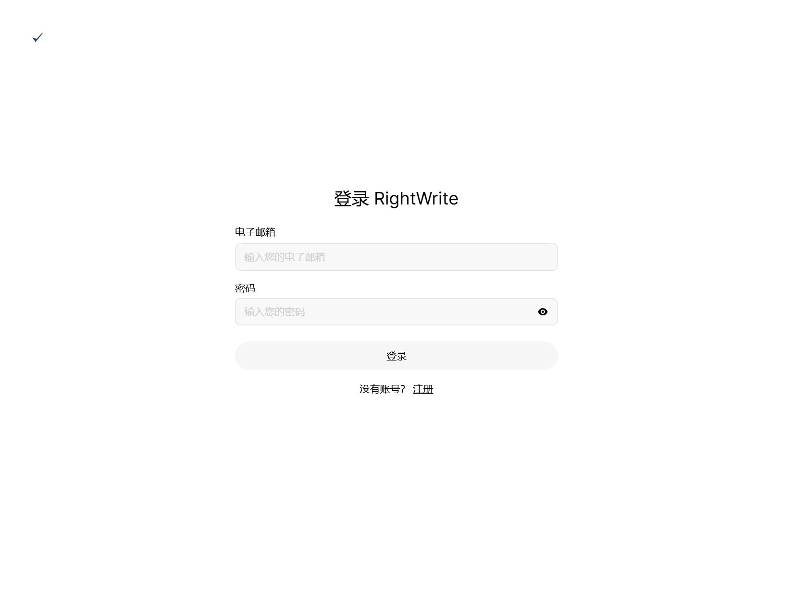
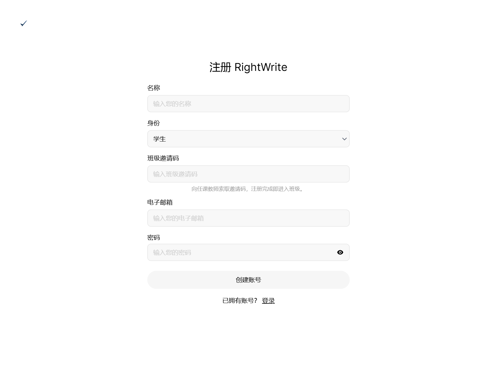
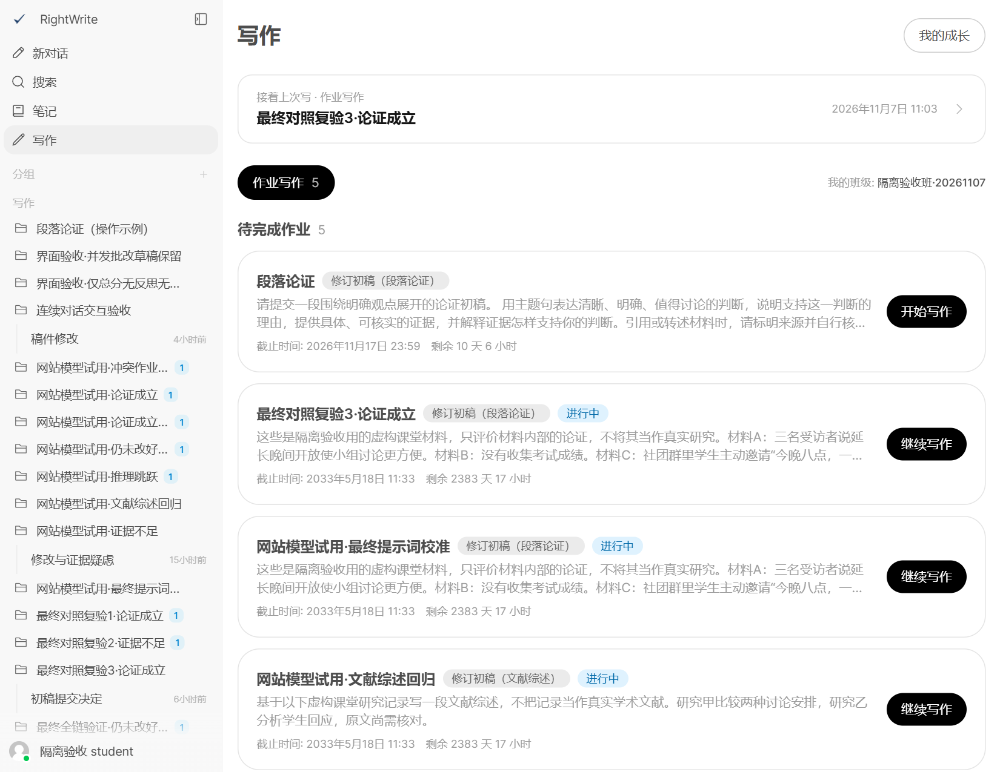
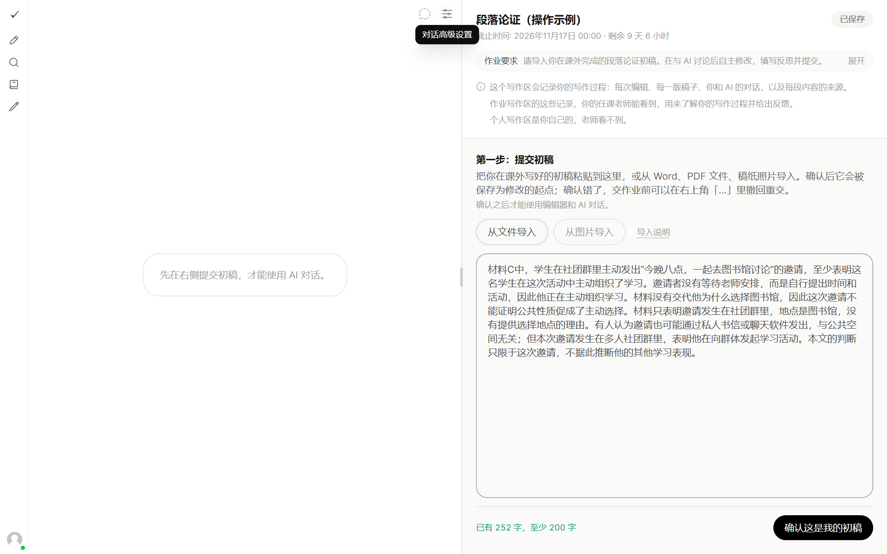
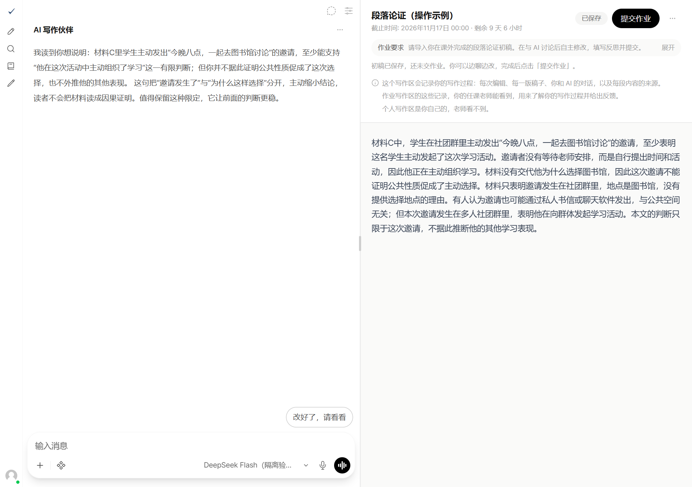
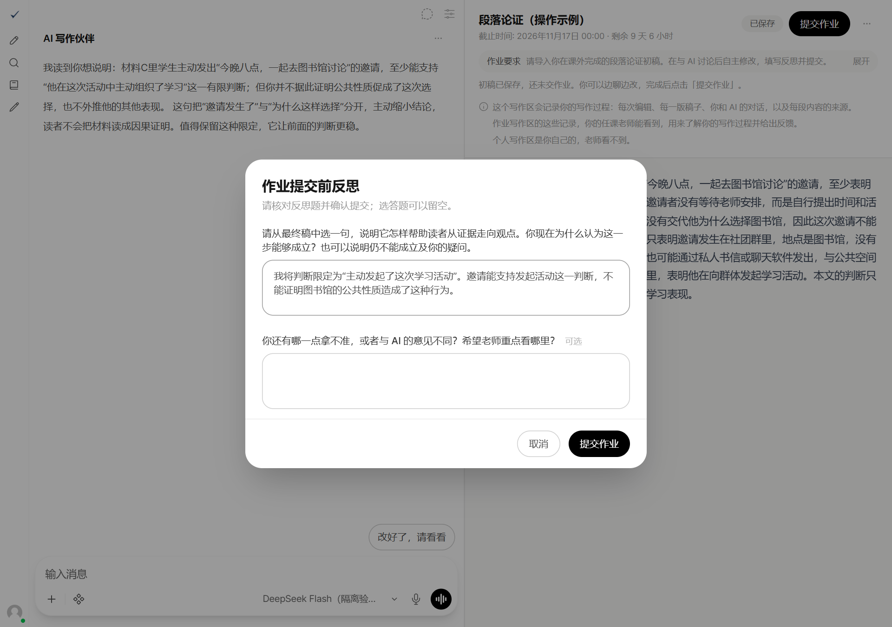
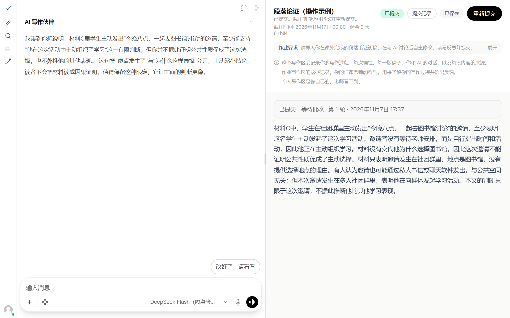
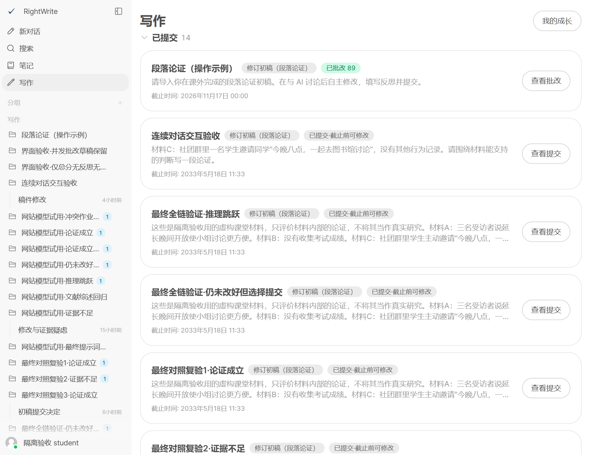
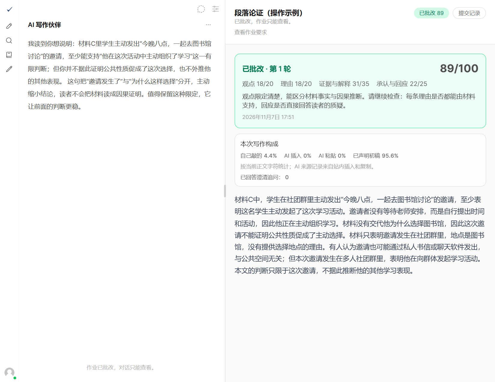

# 学生使用手册 · 段落论证

## 1　注册、登录与入班

完整流程：注册入班 → 打开作业 → 导入初稿 → 讨论修改 → 提交反思 → 查看反馈。

### 打开网站，点击注册
先向老师索取班级邀请码。浏览器访问 https://hitsz.rightwrite.cc，在登录页下方点击「注册」。已有账号直接输入邮箱和密码，点击「登录」。

### 填写注册信息
依次填写：真实姓名 → 身份选「学生」→老师给的班级邀请码→邮箱→密码，点击「创建账号」。注册成功后自动加入该班级。

 

### 确认已经入班
进入「写作」页面，检查「我的班级」是否正确。以后使用注册邮箱和密码登录，无需再次注册或重新填邀请码。

> 邀请码无效时联系老师；班级不对时请老师或管理员调整，不要重复注册。

## 2　打开作业，导入初稿

### 在哪里打开本次作业
点击左侧「写作」，在「作业写作」的「待完成作业」中找到老师布置的「段落论证」，点击卡片右侧「开始写作」。写过的作业显示「继续写作」。

### 阅读要求，确认初稿
进入后先看右上方的作业要求和截止时间。在右侧粘贴初稿，或点「从文件导入」「从图片导入」，导入后核对错字和遗漏。

达到页面要求的至少 200 字后，点击「确认这是我的初稿」，开始与 AI 讨论和修改。

> 确认初稿只是开始修改，还没有正式交作业。

## 3　与 AI 讨论，自己改稿

### 左边看反馈、提问题
确认初稿后，AI 会先阅读。在左下方输入问题，点击输入框右侧发送按钮。例如：“这条证据能支持我的观点吗？”

### 右边修改正文，请 AI 再看
在右侧编辑器直接修改。出现「改好了，请看看」时，可点击请 AI 复看新稿；也可先输入修改说明，再点击「发送说明，请看修改」。

### 下次从哪里继续
等右上角显示「已保存」再离开。下次登录后，进入「写作」，找到同一作业，点「继续写作」。

> AI 建议由你判断是否采纳，无需 AI 认可才能提交。老师能查看作业中的写作、修改和对话过程。

## 4　填写反思，正式提交

### 点击提交，回答反思题
检查正文已保存，点击右上角「提交作业」。在弹窗回答必答题，选答题可留空；检查后再点击弹窗里的「提交作业」。

### 怎样确认已经交上
看到「已提交」及提交时间，才算交上。点击「提交记录」可核对已交稿件。只看到「已保存」，表示保存了草稿，还未提交。

> 截止前且老师尚未批改时，可以继续修改，但改完必须再点「重新提交」，老师才会收到新稿。

## 5　重新打开，查看老师反馈

### 从已提交列表进入
登录后点击左侧「写作」，展开「已提交」，找到本次作业。未批改时点「查看提交」，已批改时点「查看批改」。

### 看成绩、评语与已交稿件
老师完成批改后，作业右侧显示「已批改」、总分、各项得分和评语。先读评语，再对照正文；「提交记录」可回看已交内容。

> 已批改或已截止后只能查看。若没有找到作业，先检查班级，再向老师确认是否已经发布。
