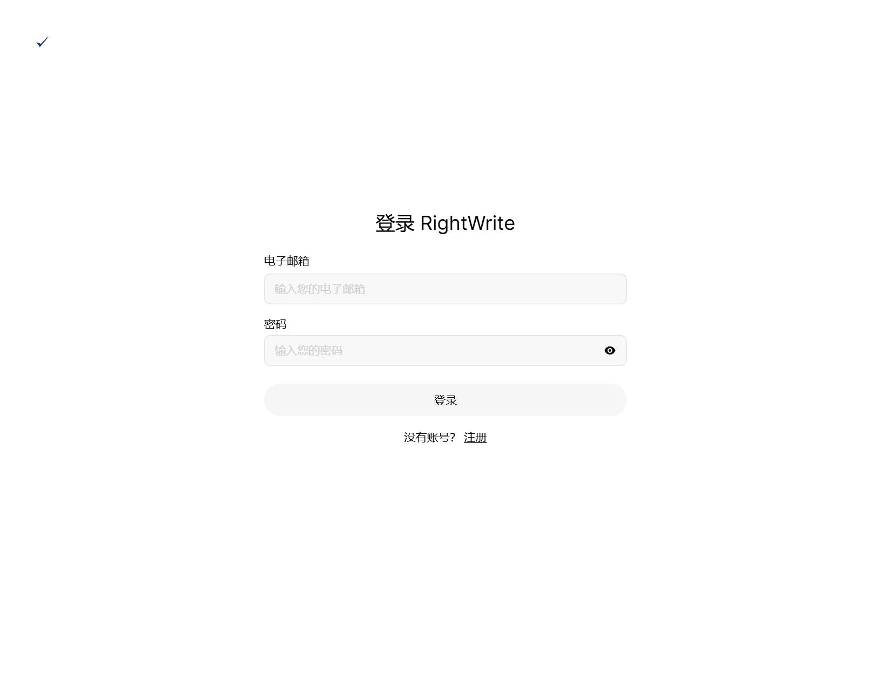
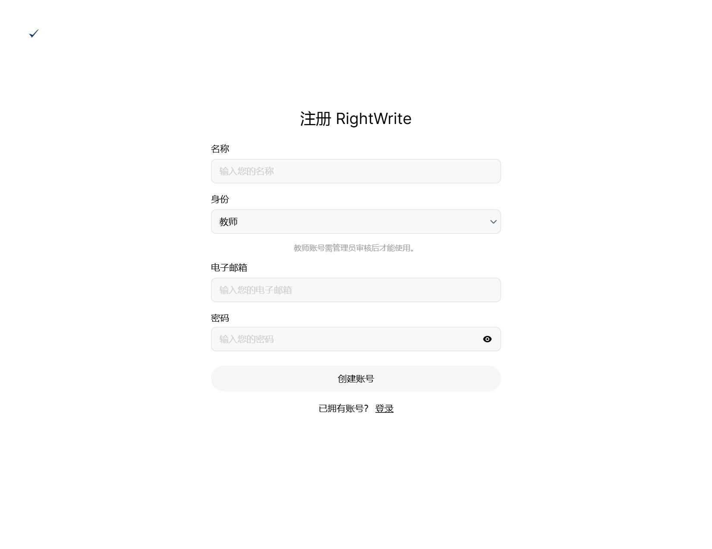
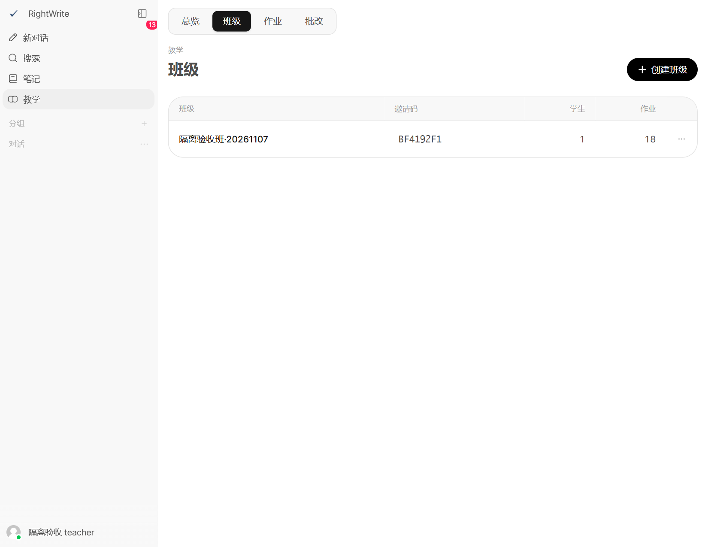
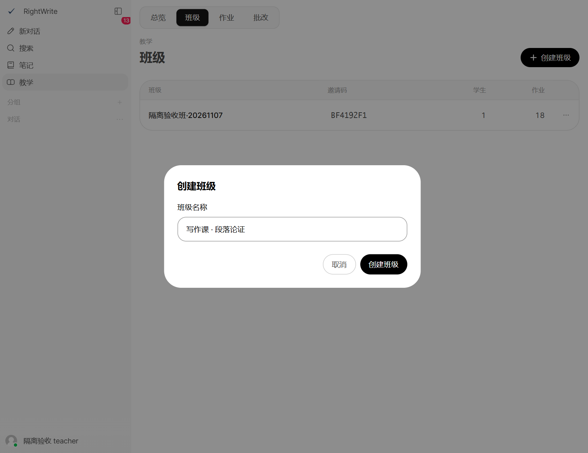
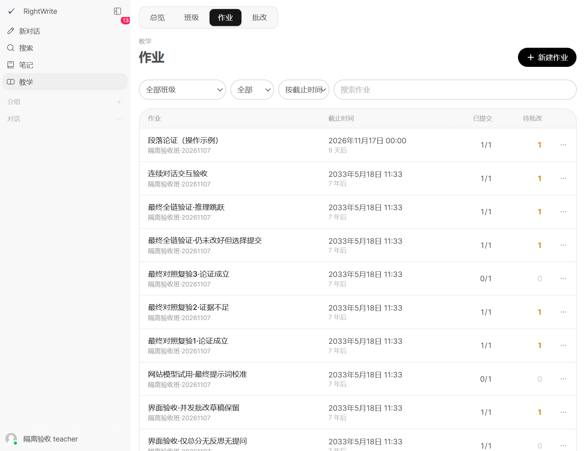
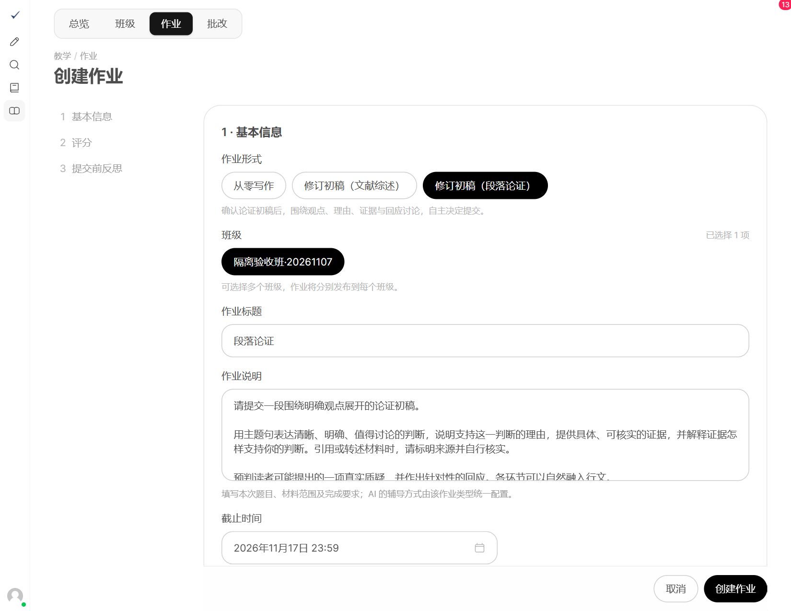
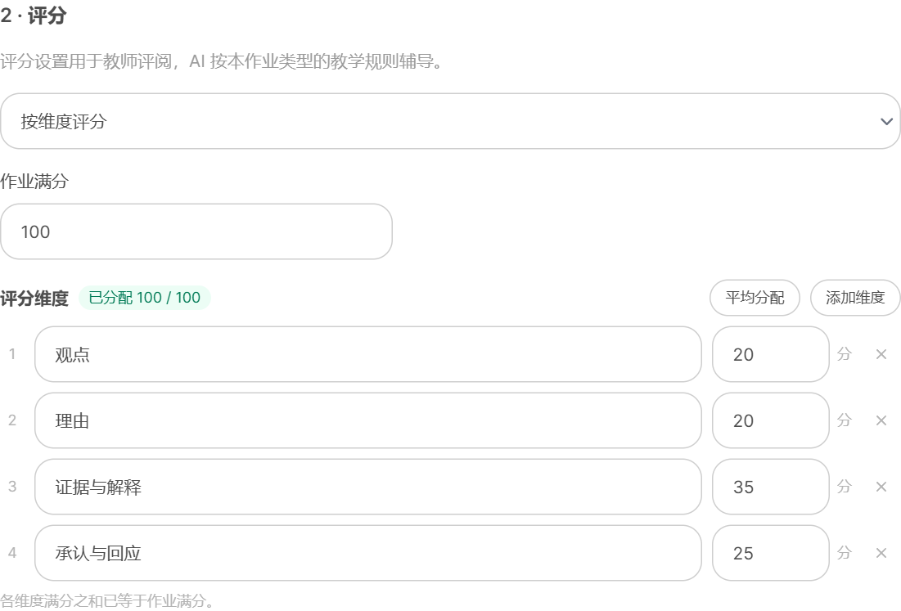
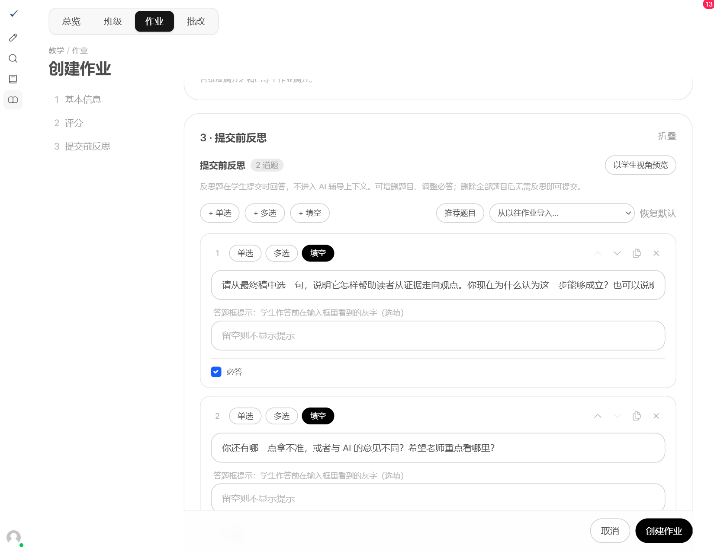
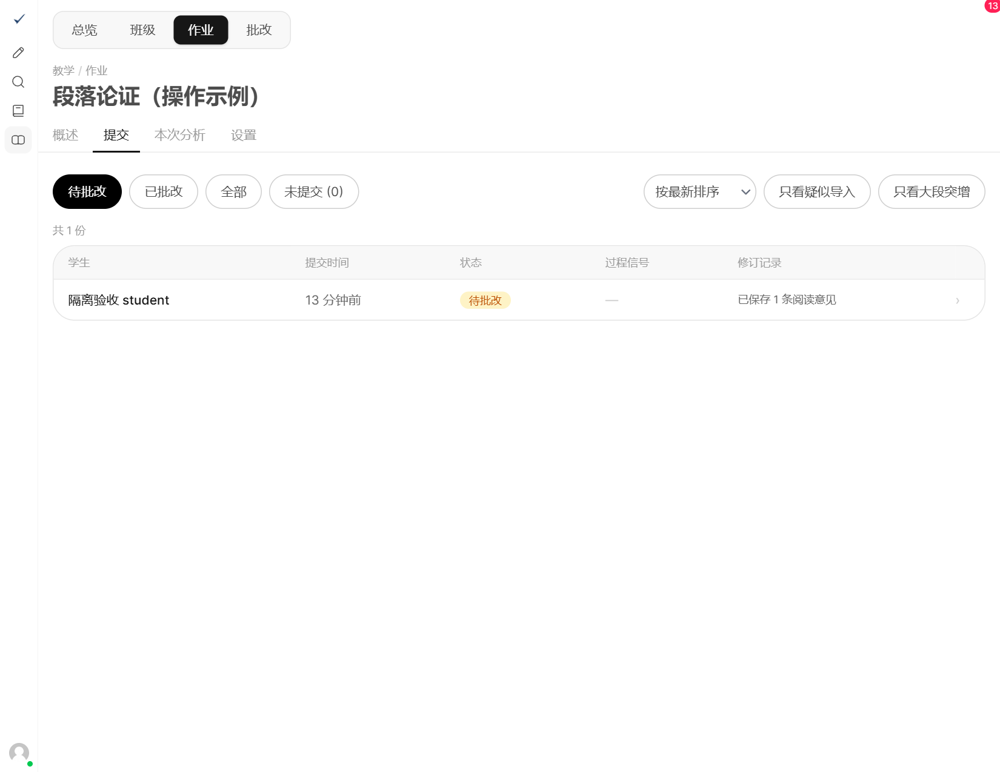

# 教师使用手册 · 段落论证

## 1　注册与登录

完整流程：注册登录 → 建班邀请 → 新建作业 → 发布作业 → 查看提交 → 批改反馈。

### 打开网站
浏览器访问 https://hitsz.rightwrite.cc。已有教师账号：填写邮箱和密码，点击「登录」；没有账号：点击下方「注册」。

### 注册教师账号
填写姓名，将「身份」选为「教师」，填写邮箱、密码，点击「创建账号」。教师不需要班级邀请码；若提示待审核，请联系管理员，通过后再登录。

 

### 登录后从哪里开始
点击左侧「教学」。顶部的「班级」用于建班，「作业」用于布置任务，「批改」用于查看学生提交。

> 注册时使用真实姓名，便于师生识别。已有可用账号无需重新注册。

## 2　创建班级，邀请学生

### 进入班级页面
左侧「教学」→顶部「班级」→右上角「创建班级」。已有课程班时，直接使用原班级。

### 填写班级名称
在弹窗填写名称，例如“写作课 · 段落论证”，点击弹窗内的「创建班级」。成功后，班级会出现在列表中。

### 把邀请码发给学生
在班级列表找到对应的「邀请码」，复制并发给学生。学生注册时填写该码，注册成功即进入这个班级。

进入班级的「学生」页面，检查学生是否已加入、姓名是否正确。

> 截图中的班级名和邀请码仅为示例，请发放自己班级的邀请码。

## 3　新建「段落论证」作业

### 找到新建入口
左侧「教学」→顶部「作业」→右上角「新建作业」。

### 填写基本信息
选择「修订初稿（段落论证）」→选择课程班→填写作业标题和说明。说明中写清本次材料与完成要求。

点击「截止时间」，选择日期、小时和分钟，再点「确认」。继续向下设置评分与反思。

> 没有「段落论证」选项时，请联系管理员开通。

## 4　确认设置，发布作业

### 确认评分
可沿用四项默认评分：观点 20、理由 20、证据与解释 35、承认与回应 25；也可改为「仅总分与总评」。

### 确认反思，点击创建
默认第一题必答、第二题选答，可按课堂需要调整。核对班级、要求与截止时间后，点击右下角「创建作业」，作业即发布到所选班级。

成功后可在「作业」列表看到新作业；学生进入「写作」即可看到它。需要调整要求或截止时间时，打开作业的「设置」。

> 已有学生提交后，评分方式、维度与满分不能再修改。

## 5　查看提交，完成批改

### 打开待批改稿件
「作业」→打开本次作业→「提交」→点击学生姓名。「未提交」可查看未交名单；全局「批改」也可进入待批改队列。

### 阅读后评分
左侧读终稿，点「初稿 → 终稿」比较修改。右侧「查看写作过程」回看交流，「反思与版本」查看反思。

填写各项得分、适用的反思／提问质量和总体评语，点击「完成批改」。连续批改可点「完成批改，下一份」。

> 状态变为「已批改」后，学生能看到成绩与评语。「存草稿」不会发布成绩；完成批改后，学生只能查看作业。
