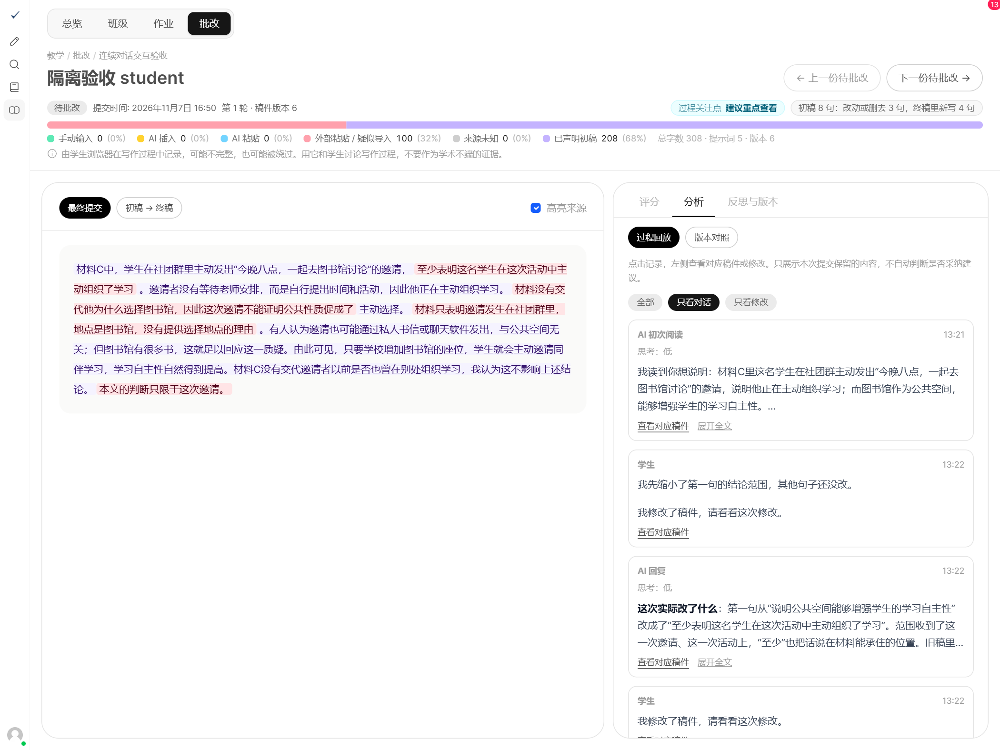
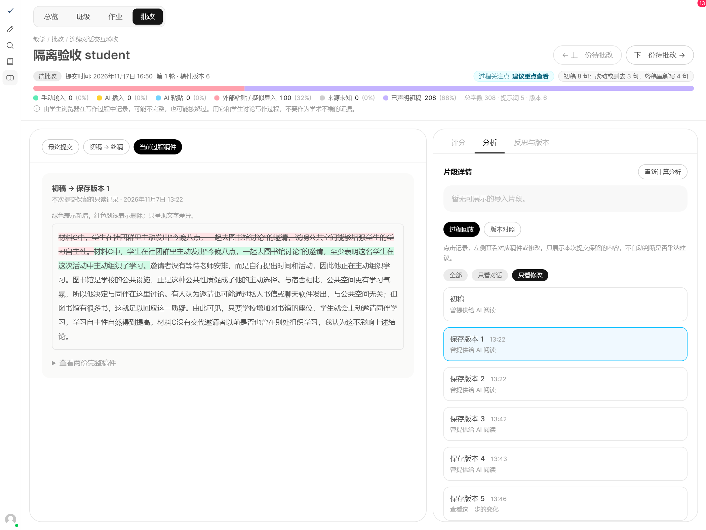
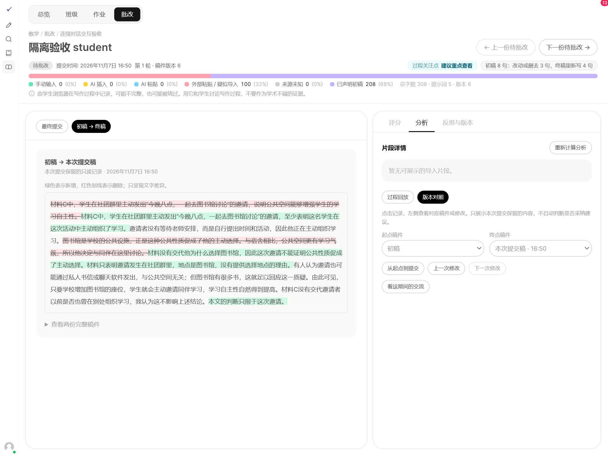
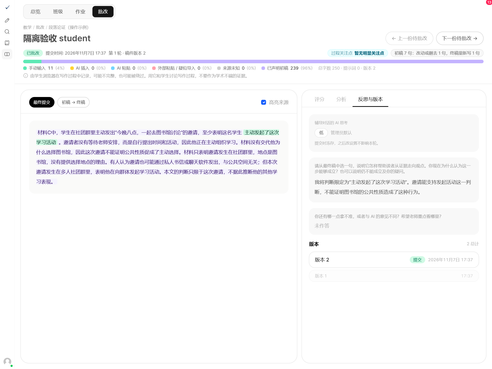

# 教师使用手册 · 段落论证

## 1　注册与登录

完整流程：注册登录 → 建班邀请 → 新建作业 → 发布作业 → 查看提交 → 批改反馈。

### 打开网站
浏览器访问 https://hitsz.rightwrite.cc。已有教师账号：填写邮箱和密码，点击「登录」；没有账号：点击下方「注册」。

### 注册教师账号
填写姓名，将「身份」选为「教师」，填写邮箱、密码，点击「创建账号」。教师不需要班级邀请码；若提示待审核，请联系管理员，通过后再登录。

 

### 登录后从哪里开始
点击左侧「教学」。顶部的「班级」用于建班，「作业」用于布置任务，「批改」用于查看学生提交。

> 注册时使用真实姓名，便于师生识别。已有可用账号无需重新注册。

## 2　创建班级，邀请学生

### 进入班级页面
左侧「教学」→顶部「班级」→右上角「创建班级」。已有课程班时，直接使用原班级。

### 填写班级名称
在弹窗填写名称，例如“写作课 · 段落论证”，点击弹窗内的「创建班级」。成功后，班级会出现在列表中。

### 把邀请码发给学生
在班级列表找到对应的「邀请码」，复制并发给学生。学生注册时填写该码，注册成功即进入这个班级。

进入班级的「学生」页面，检查学生是否已加入、姓名是否正确。

> 截图中的班级名和邀请码仅为示例，请发放自己班级的邀请码。

## 3　新建「段落论证」作业

### 找到新建入口
左侧「教学」→顶部「作业」→右上角「新建作业」。

### 填写基本信息
选择「修订初稿（段落论证）」→选择课程班→填写作业标题和说明。说明中写清本次材料与完成要求。

点击「截止时间」，选择日期、小时和分钟，再点「确认」。继续向下设置评分与反思。

> 没有「段落论证」选项时，请联系管理员开通。

## 4　确认设置，发布作业

### 确认评分
可沿用四项默认评分：观点 20、理由 20、证据与解释 35、承认与回应 25；也可改为「仅总分与总评」。

### 确认反思，点击创建
默认第一题必答、第二题选答，可按课堂需要调整。核对班级、要求与截止时间后，点击右下角「创建作业」，作业即发布到所选班级。

成功后可在「作业」列表看到新作业；学生进入「写作」即可看到它。需要调整要求或截止时间时，打开作业的「设置」。

> 已有学生提交后，评分方式、维度与满分不能再修改。

## 5　打开提交，查看对话

### 打开待批改稿件
「作业」→打开本次作业→「提交」→点击学生姓名。左侧先读「最终提交」；「未提交」可查看未交名单。

### 在「分析」里看学生怎样与 AI 交流
右侧点「分析」→「过程回放」→「只看对话」，按时间查看 AI 初次阅读、学生提问与 AI 回复。

点「展开全文」读完整回复；点「查看对应稿件」，左侧会显示当时供 AI 阅读的稿件，便于核对这条反馈针对哪一版。

## 6　回放修改，对照版本

### 「只看修改」：看每一步改了什么
在「过程回放」点「只看修改」，再点某个「保存版本」或「本次提交稿」。左侧切到「当前过程稿件」，显示前一步到这一步的变化；点「初稿」则看初稿全文。

需要更细的输入、删除记录时，展开底部「详细编辑记录」；若出现「显示中间自动保存版本」，可勾选查看。

### 「版本对照」：选择两稿进行比较
点「版本对照」，选择「起点稿件」与「终点稿件」。「从起点到提交」看整体变化，「上一次修改／下一次修改」逐步检查。

点「看这期间的交流」，右侧只显示所选时间段的对话；点「查看全部过程」取消筛选。左侧「查看两份完整稿件」可展开两稿全文。

> 这里只展示本次提交保留的过程。颜色表示文字增删，不等于修改质量，也不自动判定学生是否采纳了 AI 建议。

## 7　查看反思，完成评分

### 核对学生的反思
右侧点「反思与版本」，阅读每道反思题的回答，对照实际稿件和修改过程。版本列表可核对保存版本及提交时间；初读与聊天记录在「分析」中查看。

### 回到「评分」，发布反馈
点「评分」返回评阅。按设置填写各项得分或总分，评价适用的反思／提问质量，并填写总体评语。判断提问与反思的质量，不按对话次数打分。

点击「完成批改」发布；连续批改可点「完成批改，下一份」。查看过程时已经填写的评分与评语会保留。

> 状态变为「已批改」后，学生能看到成绩与评语。「存草稿」不会发布成绩；完成批改后，学生只能查看作业。
